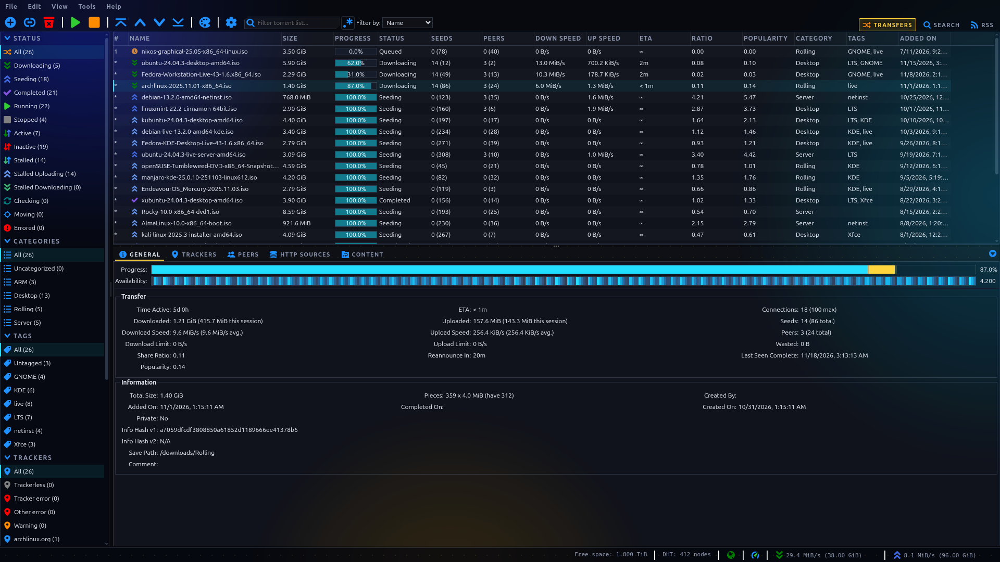

# Hazard Glass

A dark theme for the qBittorrent WebUI: frosted-glass panels over a deep
blue/teal backdrop, sci-fi console accents, **amber for actions and focus**,
**cyan for data**.



It is not a new WebUI. It is the **official WebUI** of a given qBittorrent
release with a stylesheet on top and two tiny JS patches, so every feature keeps
working: adding torrents, context menus, categories and tags, Options, RSS,
search and logs. The layout is the stock one.

**English only for now:** an alternative WebUI reads its translations from
`translations/webui_<locale>.qm`, and the build does not produce those files
yet. Other languages show the English text.

## Install

1. Download `hazard-glass-<version>-release-<qbt>.zip` from
   [Releases](../../releases), matching your qBittorrent version.
2. Unzip it somewhere the qBittorrent user can read, e.g. `/opt/hazard-glass/`.
3. In **Tools → Options → WebUI**, tick **Use alternative WebUI** and point
   it to the `webui` folder you just unzipped.
   Headless setups can set the same in `qBittorrent.conf`:
   `WebUI\AlternativeUIEnabled=true` and `WebUI\RootFolder=/opt/hazard-glass/webui`.
4. Hard-reload the WebUI page (Ctrl+Shift+R).

**To go back** to the stock WebUI, untick the option. If the folder disappears
or has no `index.html`, `qbittorrent-nox` falls back to the stock WebUI on its
own.

### Keep the stock security headers

With *any* alternative WebUI, qBittorrent **stops sending** its
`Content-Security-Policy`, `Cross-Origin-Opener-Policy` and `Referrer-Policy`
headers. To keep the same protection as the stock WebUI, enable
**Options → WebUI → Add custom HTTP headers** with:

```
content-security-policy: default-src 'self'; style-src 'self' 'unsafe-inline'; img-src 'self' data:; script-src 'self' 'unsafe-inline'; object-src 'none'; form-action 'self'; frame-src 'self' blob:; frame-ancestors 'self';
cross-origin-opener-policy: same-origin
referrer-policy: same-origin
```

Write the header names in **lower case**: that way they replace the partial
policy qBittorrent still sends, instead of adding a second header next to it.
If the WebUI is served over HTTPS, add `upgrade-insecure-requests;` at the end
of the policy, like the stock WebUI does.

The theme loads nothing from outside your server: no web fonts, scripts or
images.

## Compatibility

- qBittorrent **5.3.0** (other versions: build it yourself, see below).
- A browser with CSS nesting and `:has()`: Chrome/Edge/Brave 120+,
  Firefox 121+, Safari 17.2+.

## Build it yourself

```sh
tools/build.sh                  # qBittorrent version in QBT_TAG
tools/build.sh release-5.4.0    # any other qBittorrent release tag
```

Needs `bash`, `git` and `patch` (`zip` or `python3` for the release archive).
Output: `dist/webui/` and `dist/hazard-glass-<version>-<tag>.zip`.

How it is put together:

```
official WebUI (sparse clone of src/webui/www at the tag)
  + patches/*.patch          two small JS fixes, described at the top of each file
  + theme/hazard-glass.css   appended to style.css (dialogs are iframes that
                             load style.css only, so they get the theme too)
  = dist/webui/
```

When a new qBittorrent release changes the patched lines, the build stops and
names the patch that needs updating.

## Demo mode

Try the theme, or work on it, without a qBittorrent instance:

```sh
tools/build.sh
node tools/demo/server.mjs          # http://127.0.0.1:8099/
```

It serves `dist/webui` with a fake, read-only Web API full of Linux ISOs
(Node 18+, no dependencies). `HOST=0.0.0.0` makes it reachable from other
machines. The screenshots in this README come from it.

## Contributing

Read [docs/design.md](docs/design.md) first. The one hard rule: the stylesheet
must not change any **size** (margin, padding, border width, height,
font-size, display). The WebUI's layout engine (MochaUI) computes panel heights
in JavaScript, and any difference makes one panel swallow the other.

## Credits

The look is inspired by the *Acrylic* and *Hazard* styles of the
ps5-homebrew-ui project. Built on the qBittorrent WebUI.

## License

GPL-2.0-or-later, like the qBittorrent WebUI it is built from. See
[LICENSE](LICENSE).
